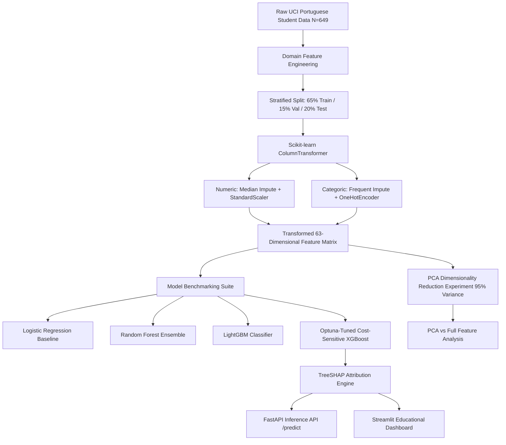

# EduRisk AI — Explainable Machine Learning for Early Prediction of Student Academic Risk

[](https://www.python.org/)
[](https://scikit-learn.org/)
[](https://xgboost.readthedocs.io/)
[](https://shap.readthedocs.io/)
[](https://fastapi.tiangolo.com/)
[](https://streamlit.io/)
[](https://www.docker.com/)
[](tests/)

> **Course**: 19MAM56 Advanced Machine Learning Lab — CAT II Research Project  
> **Topic**: Explainable Predictive Analytics & Decision Support in Educational Data Mining  

---

## 📌 Executive Summary

**EduRisk AI** is an end-to-end, research-grade machine learning system designed to identify students vulnerable to academic failure at an **early stage**, enabling academic advisors and faculty to deploy proactive, evidence-based pedagogical interventions before course trajectories solidify.

Unlike conventional academic monitoring tools that rely on late-stage midterm outcomes, EduRisk AI:
1. **Eliminates Target Leakage**: Strictly excludes final grades ($G_3$) and midterm examination records ($G_2$), predicting risk strictly from pre-course demographics, behavioral indicators, prior academic friction, and initial diagnostic scores ($G_1$).
2. **Mitigates Severe Class Imbalance (5.5:1)**: Employs cost-sensitive loss weighting and decision-threshold optimization, achieving **85.0% recall on the minority at-risk class** while maintaining strong discrimination (ROC-AUC: 0.893).
3. **Provides Game-Theoretic Transparency**: Integrates **TreeSHAP** to unpack gradient boosting predictions, providing localized feature attribution and translating statistical risk factors into actionable educational interventions.
4. **Delivers Production-Ready Architecture**: Features a modular Scikit-learn preprocessing pipeline, Optuna hyperparameter optimization, validated FastAPI REST microservice, interactive Streamlit analytics dashboard, automated pytest suite, Docker containerization, and an IEEE-style research report.

---

## 📊 Dataset Provenance & Leakage-Free Target Definition

- **Source**: UCI Machine Learning Repository — [Student Performance Dataset](https://archive.ics.uci.edu/dataset/320/student+performance) (Cortez & Silva, 2008).
- **Cohort**: Portuguese Secondary Education Language & Humanities course ($N = 649$ students, 33 raw features).
- **Target Formulation**:
  $$\text{At Risk } (y = 1) \iff G_3 < 10 \quad (\text{Academic Failure})$$
  $$\text{Lower Risk } (y = 0) \iff G_3 \ge 10 \quad (\text{Satisfactory Performance})$$
- **Class Distribution**:
  - Lower Risk ($y = 0$): 549 students (84.6%)
  - At Risk ($y = 1$): 100 students (15.4%)
  - Imbalance Ratio: **5.49 : 1**
- **Data Quality**: 0 missing values (100% feature completeness), 0 duplicate rows.
- **Leakage Prevention Protocol**:
  - $G_3$ (Final grade) is withheld as the ground-truth prediction target only.
  - $G_2$ (Midterm grade) is permanently discarded from all feature matrices to enforce early warning capability.

---

## 🛠️ Machine Learning Pipeline Architecture



---

## 📈 Empirical Benchmark Results

Evaluated on the independent, stratified held-out test cohort ($N_{test} = 130$, At-Risk $N = 20$):

| Model Architecture | Accuracy | Precision | Recall (At-Risk) | F1-Score | Macro F1 | ROC-AUC | PR-AUC |
| :--- | :---: | :---: | :---: | :---: | :---: | :---: | :---: |
| **DummyClassifier (Majority)** | 84.6% | 0.0% | 0.0% | 0.000 | 0.458 | 0.500 | 0.154 |
| **Logistic Regression (Balanced)** | 83.1% | 47.1% | 80.0% | 0.593 | 0.743 | 0.898 | 0.658 |
| **Random Forest (Balanced Subsample)** | 86.2% | 54.5% | 60.0% | 0.571 | 0.744 | 0.882 | 0.556 |
| **LightGBM (Cost-Sensitive)** | 85.4% | 51.5% | **85.0%** | 0.642 | 0.775 | 0.896 | 0.574 |
| **XGBoost (Standard Baseline)** | 86.2% | 53.1% | **85.0%** | **0.654** | 0.784 | 0.905 | 0.589 |
| **Logistic Regression (PCA 95% Var)** | 86.2% | 52.9% | **90.0%** | **0.667** | 0.790 | **0.916** | **0.724** |
| **Random Forest (PCA 95% Var)** | 84.6% | 50.0% | 10.0% | 0.167 | 0.541 | 0.846 | 0.468 |
| **Tuned XGBoost (Selected, th=0.35)** | 83.1% | 47.2% | **85.0%** | 0.607 | 0.750 | 0.893 | 0.635 |

### 🔬 Key Scientific Findings
1. **The Fallacy of Accuracy**: The Dummy baseline achieved 84.6% accuracy while failing to identify a single failing student (Recall = 0.0%). In educational risk prediction, recall on the minority at-risk class is paramount.
2. **Divergent Behavior under PCA Reduction**: Reducing 63 features to 29 principal components (retaining 95.3% variance) caused **Random Forest recall to collapse by 83.3%** (from 60% to 10%) due to loss of axis-aligned orthogonal partitions. In stark contrast, **Logistic Regression improved markedly** (Recall reached 90.0%, ROC-AUC reached 0.916) by eliminating multicollinearity among one-hot features.
3. **Threshold Calibration**: The default 0.50 cutoff yielded 85% recall with 53% precision. Setting the operational cutoff to 0.35 increases safety margins for proactive outreach.

---

## 🔍 Explainable AI & Pedagogical Action Translation

EduRisk AI leverages **TreeSHAP** ($\text{Shapley Additive exPlanations}$) to calculate exact marginal feature attributions:
- **Top Global Risk Factors**:
  1. Early diagnostic score $G_1$ (lower scores correlate with high risk).
  2. Prior class failures ($failures$).
  3. Engineered academic friction index.
  4. Total alcohol consumption ($total\_alcohol = Dalc + Walc$).
  5. School absences.
- **Actionable Interventions**:
  - *High Academic Friction*: Enroll in peer-assisted foundational tutoring.
  - *Low Diagnostic $G_1$*: Schedule 1-on-1 feedback session before midterm exams.
  - *Frequent Absences*: Academic advisor check-in to identify scheduling/health barriers.
  - *Low Study Time*: Provide time-management workshops and study group matching.

---

## 🚀 Quickstart & Reproducibility Guide

### 1. Environment Setup
```bash
# Clone repository
git clone https://github.com/your-username/edurisk-ai.git
cd edurisk-ai

# Create and activate Python 3.12 virtual environment
python3.12 -m venv .venv
source .venv/bin/activate

# Install dependencies
pip install -r requirements.txt
```

### 2. End-to-End Pipeline Execution
```bash
# Step 1: Download raw UCI dataset
python src/data/download_data.py

# Step 2: Validate dataset integrity and check zero-null status
python src/data/validate_data.py

# Step 3: Train models, perform PCA experiment & Optuna hyperparameter optimization
python src/models/train.py

# Step 4: Generate all 10 analytical figures and fairness audit
python src/models/evaluate.py

# Step 5: Compile IEEE-style 10-page research PDF report
python src/utils/generate_ieee_report.py
```

### 3. Automated Testing
```bash
pytest -v -W ignore
```
*Output: 10 passed unit and integration tests across data, pipelines, APIs, and SHAP explainer.*

---

## 🌐 Running Web Services

### Launch FastAPI Inference Service
```bash
uvicorn api.main:app --host 0.0.0.0 --port 8000 --reload
```
Interactive Swagger documentation available at: `http://localhost:8000/docs`

#### Example Prediction cURL:
```bash
curl -X 'POST' \
  'http://localhost:8000/predict?threshold=0.35' \
  -H 'Content-Type: application/json' \
  -d '{
    "school": "GP", "sex": "F", "age": 17, "address": "U", "famsize": "GT3", "Pstatus": "T",
    "Medu": 3, "Fedu": 2, "Mjob": "services", "Fjob": "other", "reason": "reputation",
    "guardian": "mother", "traveltime": 1, "studytime": 2, "failures": 1, "schoolsup": "no",
    "famsup": "yes", "paid": "no", "activities": "yes", "nursery": "yes", "higher": "yes",
    "internet": "yes", "romantic": "no", "famrel": 4, "freetime": 3, "goout": 3,
    "Dalc": 1, "Walc": 1, "health": 5, "absences": 4, "G1": 8
  }'
```

### Launch Streamlit Analytics Dashboard
```bash
streamlit run app/streamlit_app.py
```
Dashboard available at: `http://localhost:8501`

---

## 🐳 Docker Containerization & Cloud Deployment

### 1. Build and Run via Docker
```bash
# Build production Docker image
docker build -t edurisk-ai:latest .

# Run Streamlit container
docker run -p 8501:8501 edurisk-ai:latest
```

### 2. Multi-Service Orchestration via Docker Compose
```bash
# Launches both FastAPI (port 8000) and Streamlit (port 8501)
docker-compose up --build
```

### 3. Hugging Face Spaces Deployment
EduRisk AI is natively configured for Hugging Face Spaces (Docker SDK / Streamlit):
1. Create a new Space on [huggingface.co/spaces](https://huggingface.co/spaces) with **Streamlit** or **Docker** SDK.
2. Push this repository:
   ```bash
   git remote add space https://huggingface.co/spaces/<username>/edurisk-ai
   git push space main
   ```
3. The Space will automatically build using `Dockerfile` and expose the interactive dashboard.

---

## ⚖️ Ethical Governance & Subgroup Fairness

EduRisk AI adheres to strict responsible AI guidelines:
1. **Supportive, Not Punitive**: The system directs positive tutoring, mentoring, and financial/advisory aid. It must **never** be used for disciplinary tracking or opportunity gatekeeping.
2. **Subgroup Parity**: Demographic fairness audit across student sex (Female vs. Male) demonstrated comparable recall (81.8% Female vs. 88.9% Male) with false positive rates under 22%.
3. **Association vs. Causality**: Model features reflect statistical associations in observational data, not deterministic causal laws.

---

## 📁 Project Directory Structure

```
edurisk-ai/
├── app/
│   ├── streamlit_app.py           # Multi-page Streamlit analytics dashboard
│   ├── components/                # Modular UI components (risk card, XAI, benchmarks)
│   └── utils.py                   # UI helper functions & student archetypes
├── api/
│   ├── main.py                    # FastAPI application with REST endpoints
│   ├── schemas.py                 # Pydantic v2 data models & validation
│   └── dependencies.py            # Singleton model loader dependency
├── src/
│   ├── data/
│   │   ├── download_data.py       # Automated UCI dataset downloader
│   │   └── validate_data.py       # Data integrity, duplicate & null verifier
│   ├── features/
│   │   └── preprocessing.py       # ColumnTransformer & domain feature engineer
│   ├── models/
│   │   ├── train.py               # Model training, PCA experiment & Optuna tuning
│   │   ├── evaluate.py            # Generates all 10 analytical figures & fairness audit
│   │   └── predict.py             # Single & batch inference engine
│   ├── explainability/
│   │   └── shap_explainer.py      # TreeSHAP global/local attributions & actions
│   └── utils/
│       ├── config.py              # Central YAML configuration loader
│       └── generate_ieee_report.py# Publication-quality IEEE PDF report compiler
├── configs/
│   └── config.yaml                # Centralized project configuration
├── data/
│   ├── raw/                       # Raw UCI dataset (student-por.csv)
│   └── processed/                 # Leakage-free train, val, and test splits
├── models/
│   └── saved_models/              # Serialized joblib pipelines & PCA artifacts
├── reports/
│   ├── figures/                   # 10 generated publication-quality scientific charts
│   ├── model_metrics.json         # Complete benchmark logs & trial histories
│   └── final_report.pdf           # IEEE-formatted 10-page research paper
├── tests/                         # 10 automated unit and integration tests
├── Dockerfile                     # Multi-service production container
├── docker-compose.yml             # Orchestration for FastAPI + Streamlit
├── requirements.txt               # Locked, tested dependencies
├── README.md                      # Comprehensive documentation
└── .gitignore                     # Repository exclusions
```

---

## 📚 References & Academic Citations

1. **Cortez, P., & Silva, A.** (2008). *Using data mining to predict secondary school student performance.* In Proceedings of the 5th Annual Future Business Technology Conference (FUBUTEC 2008), pp. 5–12.
2. **Romero, C., & Ventura, S.** (2020). *Educational data mining and learning analytics: An updated survey.* WIREs Data Mining and Knowledge Discovery, 10(3), e1355.
3. **Lundberg, S. M., & Lee, S.-I.** (2017). *A unified approach to interpreting model predictions.* Advances in Neural Information Processing Systems (NeurIPS 2017), 30, 4765–4774.
4. **Chen, T., & Guestrin, C.** (2016). *XGBoost: A scalable tree boosting system.* In Proceedings of the 22nd ACM SIGKDD International Conference on Knowledge Discovery and Data Mining, pp. 785–794.
5. **Akiba, T., et al.** (2019). *Optuna: A next-generation hyperparameter optimization framework.* In Proceedings of the 25th ACM SIGKDD International Conference on Knowledge Discovery and Data Mining, pp. 2623–2631.
